# Email architecture audit and migration

## Initial state (before this change)

| Feature | Status | Evidence / gap |
| --- | --- | --- |
| Account domain | Partially implemented | Settings.catchallDomain and Task.config.domain exist; mailbox association is not persisted in PostgreSQL. |
| Generated account email preview | Missing | No preview or visible distinction between account email and receiving inbox. |
| Inbox email | Implemented, integration partial | EmailConfig.inboxAddress and Gmail UI exist; selected mailbox ID is only held in main-process memory. |
| Gmail App Password | Implemented | Encrypted backend storage; write-only UI input; no frontend persistence. |
| IMAP settings | Partially implemented | Backend host/port/TLS exist; desktop hardcodes host/port and INBOX; no advanced UI. |
| Catch-all forwarding model | Partially implemented | Generated domain and receiving mailbox are separate in backend, but no persistent domain-to-inbox binding or clear UI. External forwarding must remain provider-managed. |
| Original-recipient OTP matching | Implemented, integration partial | Exact recipient/sender/time matching, duplicate UID protection and ambiguity rejection exist; forwarding-header coverage, tracking UI and a worker-level wait coordinator are missing. |

Additional gaps: connection test proves IMAP login only; it cannot prove DNS/catch-all delivery. No target-specific signup/OTP browser adapter is registered. UI preview must not be represented as an email that was sent or reserved.

## Migration plan

1. Add nullable EmailConfig.accountDomain and defaulted mailbox=INBOX; retain existing records, encrypted App Passwords and task config.domain. No table rebuild.
2. Expose those fields through existing schemas/repository/services; reject verification/task recipients that conflict with a bound account domain.
3. Persist the selected email-config UUID in desktop settings; make the backend domain binding authoritative when available, with legacy local preference fallback.
4. Extend existing IPC capabilities compatibly for connection options and verification-status listing. Never send OTP/App Password back in list state.
5. Refactor only Email Integration and the domain helper text in Settings: account domain + preview, receiving inbox + App Password, advanced IMAP folder/host/port, explicit external forwarding explanation and verification tracking.
6. Expand matching for forwarded-recipient headers; test raw MIME so a Gmail delivery address does not overwrite the original account recipient.
7. Add a reusable worker EmailVerificationCoordinator that creates tracking before requesting an OTP, waits with cancellation/time limits and uses the existing exact-match service. The trusted target adapter remains responsible for browser selectors and entering/submitting the code.
8. Apply additive migration to development/test databases, run UI/backend/IPC tests and refresh desktop artifacts. Do not provision external forwarding or send test messages without provider setup/authorization.

## Implemented corrections

| Feature | Current implementation |
| --- | --- |
| Account Email Domain | Dedicated UI field; nullable backward-compatible PostgreSQL binding; copied to Task.config.domain; mismatched domain rejected before start/OTP request. |
| Generated Email Preview | Read-only generated sample using the account domain; explicitly not reserved, sent or guaranteed to be the final signup address. It never uses the Gmail inbox as identity. |
| OTP Inbox | Separate Gmail address, independent of the account domain; selected EmailConfig UUID persists across desktop restarts. |
| App Password | Saved App Password reloads masked on reopening Email integration; Show/Hide reveals the saved value; AES-GCM backend storage and Gmail whitespace normalization remain in place. No plaintext browser/local preference persistence. |
| IMAP | Host, port and folder exposed under Advanced settings; implicit TLS remains mandatory. Inbox test validates folder access as well as login. Changing only the account domain preserves IMAP connection status. |
| Forwarding model | Persistent domain-to-inbox binding and visible five-step flow. Provider-side DNS/catch-all rules remain external; IMAP login never claims forwarding is configured. |
| OTP matching | Exact generated recipient + sender + time window, original-recipient header extraction, ambiguous-code refusal and folder-scoped UID reuse protection. |
| Workflow integration | BrowserWorkflowContext.waitForOtp coordinates tracking before dispatch, checkpoints request IDs without codes, and waits with cancellation/expiry. A target-specific signup/OTP browser adapter is still required. |
| Tracking | Recent metadata by selected inbox, refreshed through React Query; no OTPs, App Passwords or encrypted payloads returned. |

```mermaid
flowchart LR
    D[Account Email Domain] --> G[Generated signup email]
    G --> S[Signup / request verification]
    S --> V[Email sent to generated address]
    V --> F[External catch-all forwarding]
    F --> I[Gmail OTP Inbox]
    I --> M[IMAP read-only scan]
    M --> R[Match original recipient + sender + time]
    R --> O[Extract OTP in backend]
    O --> C[Target adapter continues signup]
```

State ownership: React Query owns mailbox/verification metadata, component-local state holds unsaved form values and the temporary App Password, existing Zustand stores remain UI-only, Electron settings persist the selected mailbox UUID and legacy preference fallback, PostgreSQL holds the canonical account-domain/inbox configuration and encrypted credentials. No extra global secret store or replacement application was introduced.

## Persistence migration

202611100001_email_roles adds email_configs.account_domain (nullable), email_configs.mailbox (default INBOX) and verification_requests.mailbox (default INBOX). The verification uniqueness key now includes mailbox, because UIDVALIDITY/UID belong to a mailbox rather than the entire Gmail account. A verification request snapshots its folder so changing settings cannot silently move an in-flight scan. The SQL migration wraps index replacement in a transaction. Existing credentials, tasks, accounts and sessions are preserved; no account domain is invented for legacy rows.

Migration was applied to the development database and both dedicated test databases. Older configurations remain readable; opening/saving Email Integration completes their explicit domain binding. Backend domain is authoritative when selected, with the existing local preference only as a legacy/unconfigured fallback. The UI Settings field synchronizes with that same binding rather than introducing a second competing value.

## Scope and verification

The existing application structure and navigation remain intact. Modified areas are the Email Integration page, Account Domain helper text in Settings, corresponding domain/IPC types and preview adapter, Electron persistence/API adapter, EmailConfig/VerificationRequest schema, IMAP parser, email/task guards and the worker's reusable OTP coordinator. Existing pages/components outside that scope are unchanged.

Verified: 66 backend tests, 15 renderer tests and eight desktop tests; strict typechecks and production builds. Raw MIME fixtures cover Gmail as final delivery address while original recipient remains alex123@mytic.website, repeated forwarding headers, wrong recipients and similar-domain non-matches. Integration tests cover legacy defaults, custom folder retention, domain guards, no-secret tracking, tracking-before-dispatch, OTP reuse across resume without resending, canonical signup domain and persisted mailbox selection. Real Electron tests exercise form -> preload/IPC -> local backend fixture -> persisted metadata; App Password is reloaded masked, can be shown/hidden, and is never stored in desktop settings.

These tests do not prove live Gmail delivery, DNS ownership, provider forwarding rules or a completed Weverse signup. No external emails were sent or accounts created. At the time of that email audit, the workflow registry remained empty. The subsequent registered WeverseAdapter is documented in ../processes/backend/docs/WEVERSE_ADAPTER.md.

Parser/API references: [MailParser raw header lines](https://nodemailer.com/extras/mailparser) and [ImapFlow read-only mailbox locks](https://imapflow.com/docs/api/imapflow-client/).

Release 0.1.1: Windows Setup and Portable EXEs were generated in release/. The packaged WeCode.exe passed the same Electron email UI/IPC/persistence smoke checks. Close the older desktop process before starting 0.1.1 so the single-instance lock does not focus the old window. No existing application process was forcibly closed and no live domain/inbox values were overwritten by test examples.

## Saved App Password convenience update (desktop 0.1.4)

- Email integration automatically reloads the selected inbox credential when opened, including after an application restart. It starts masked; Show Password and Hide Password are keyboard-accessible buttons.
- Settings links directly to the OTP inbox configuration. The account domain and OTP inbox remain separate.
- The existing PostgreSQL app_password_cipher field remains the durable encrypted source of truth. Existing saved credentials work without re-entry or a schema migration.
- GET /api/v1/email-configs/:id/app-password returns { appPassword } only with the existing desktop bearer authentication and Cache-Control: no-store. Browser-origin requests remain forbidden. Lists, workspace snapshots and events remain metadata-only.
- The allowlisted getEmailAppPassword(id) IPC capability loads only the currently selected mailbox. Plaintext lives in the active email form; it is not persisted in Zustand, localStorage, query cache or desktop-settings.json. Unmounting cancels stale loads.
- Saving unrelated fields omits an unchanged password, preserving the existing credential and IMAP status. Leaving the field blank retains the saved credential. Saving a replacement updates the encrypted value.
- Browser preview mirrors the UX with session-memory fixtures only; restarting preview does not persist mailbox credentials. Desktop persistence uses PostgreSQL.
